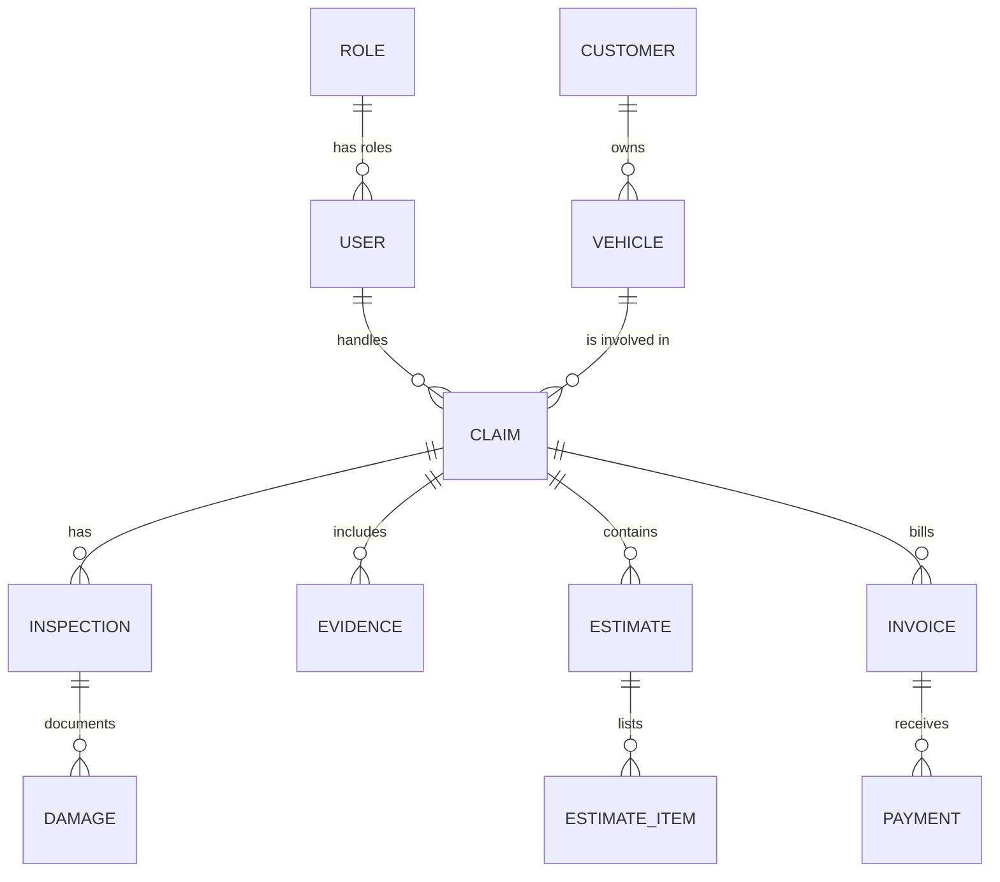
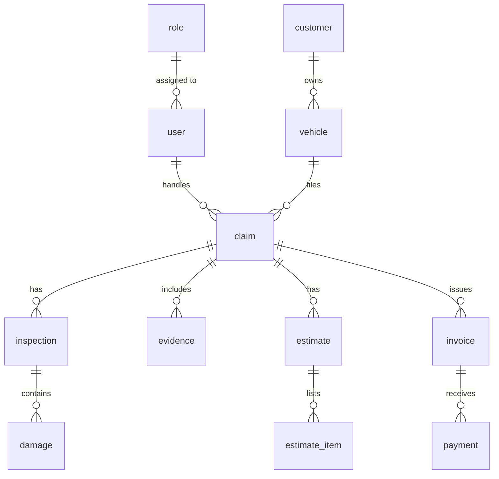
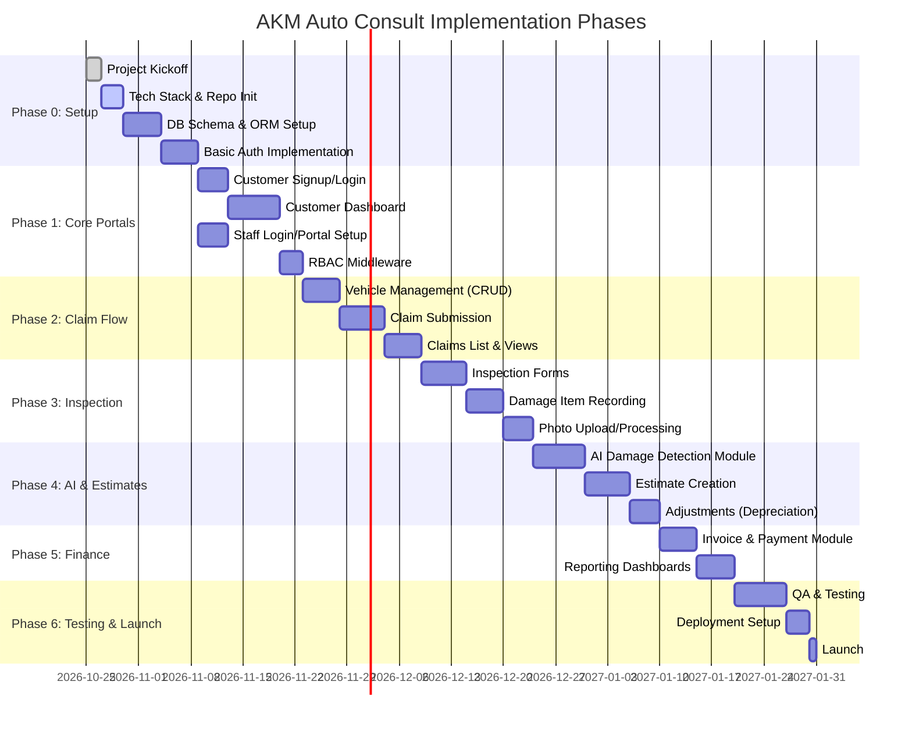

# AKM Auto Consult — System Overview & Implementation Plan

**Executive Summary:** *AKM Auto Consult* is a full-stack web application for managing motor vehicle insurance claims, accident inspections, and loss-adjustment workflows. The system connects customers, auto shops, and internal staff (claims officers, adjusters, inspectors, finance, etc.) through separate secure portals with strong role-based access control (RBAC). Key features include vehicle registration, policy and claim management, guided damage capture (with photos and structured damage records), AI-assisted damage detection and repair-cost estimation, document generation (estimates, invoices, reports), communications, and analytics. 

The tech stack is Next.js (App Router, TypeScript) for the frontend and backend, MySQL for data, Prisma (or equivalent) as the ORM, NextAuth or custom JWT auth for security, and Tailwind CSS/PostCSS for styling. The app supports light/dark modes, responsive design, image optimization (including AVIF conversion), and will be deployable on standard Apache+MySQL shared hosting. All environment-specific values (keys, DB URIs, secrets) use separate `.env.local`/`.env.production` files; no sensitive data is hardcoded. 

This documentation package (PRD, specs, API catalog, RBAC matrix, deployment guide, etc.) outlines the architecture, data model, APIs, UI structure, security measures, and an implementation roadmap. It ensures the system can capture accident vehicle damages (via inspection forms, photos, and an AI model) and compute repair estimates. Open-source AI (e.g. YOLOv8 via ONNX or TensorFlow.js) will be used for damage detection; if unavailable, a manual fallback process ensures human adjusters verify all findings. The documentation is intended to guide the OpenCode AI agent through incremental development, testing, and deployment of the AKM Auto Consult platform.

## Key Features & Acceptance Criteria

- **Customer Portal:** Customers register/log in via the public website. They can create/view their profiles, add vehicles, view their insurance policies, submit new claims, upload accident photos/docs, and track claim status. *Acceptance:* A customer can register only via `/auth/customer/signup` and then log in, and is restricted to their own claims and vehicles. 

- **Claims Workflow:** A claim is initiated by a customer (accident report). Staff (claims officer/adjuster) assign inspectors and adjusters. Inspectors record detailed damage (checkboxes, text) and attach annotated photos. Adjusters input repair estimates, apply insured contributions/depreciation, and propose adjustments. *Acceptance:* The system captures each damage item (e.g. bumper dent, windshield crack) as a record. Photos can be annotated (via optional UI) and tagged to damage records. The final estimate is itemized (parts, labor, paint, taxes, insured’s share) and can be approved by management. 

- **AI Damage Analysis:** Upon photo upload (or claim creation), an AI module runs object/damage detection on images. It suggests damaged vehicle parts or regions (e.g. “front bumper”, “left fender”) with confidence scores, and flags likely damage severity (minor/major). The user can review and confirm these suggestions. *Acceptance:* The AI component uses an open model (e.g. YOLOv8) to pre-fill damage descriptions. Performance is measured (e.g. F1 score on labeled test images if available) and a confidence threshold is set. The feature is optional: user must be able to override or skip AI suggestions. The system must store model outputs with each inspection for audit.

- **Estimate and Costing:** The app produces a repair estimate by summing parts, labor, paint, VAT, levies, and applying depreciation or policy excess. All calculations should be visible (e.g. “Itemized parts cost”, “+ VAT @15%”, “– 40% depreciation on engine”, etc.). *Acceptance:* Calculations must match regulatory tax rates (e.g. NHIL/GETFund levies at 5%, VAT at 15%). The final payable claim is clearly shown and reconciled with the original repair quote. 

- **RBAC & Portals:** There are distinct portals/pages for each user role: 
  - *Public Site* (marketing, info, customer signup). 
  - *Customer Dashboard* (claims, vehicles, policies). 
  - *Staff Dashboard* (claims queue, inspections, invoices) with sub-portals per role. 
  - *Admin/Management Console* (user/role management, settings). 

  *Acceptance:* Each role (Customer, Claims Officer, Adjuster, Inspector, Finance, Auditor, Support, etc.) logs in via a dedicated path (e.g. `/auth/claims/sign-in` vs `/auth/finance/sign-in`). Auth middleware ensures a finance user cannot log in through the claims portal. After login, UI components (menus, pages) adapt to role. The sidebar is a reusable RBAC-aware component that only shows permitted menu items.

- **Data & Documents:** The system stores and displays all evidence (photos, PDFs) securely. Uploaded images are automatically optimized to web-friendly formats (converted to AVIF or WebP) and thumbnails. Reports (inspection summary, damage report, final estimate, invoice) are generated as PDF. *Acceptance:* Image optimization uses a library like Sharp to convert large uploads to AVIF for performance. PDFs (can use Puppeteer or PDFKit) include all form data and calculate totals. An audit trail logs all critical actions (who approved, dates).

- **Security:** All pages use HTTPS. Auth is via secure cookies or JWT (HTTP-only), with passwords hashed (bcrypt). Sensitive config lives in environment variables (e.g. `.env.local`, `.env.production` as per Next.js recommendations). Role-checks are enforced on every request (deny-by-default). *Acceptance:* Code review finds no hardcoded secrets. Login endpoints lock out after several failed attempts. Regular security audit (OWASP) passes key checks.

- **Scalability & Performance:** Use Next.js static optimizations where feasible (e.g. marketing pages), server-side rendering or API routes for data. Images via `next/image` to leverage built-in optimizations. Tailwind utility CSS for small bundle size. Code-splitting and minification enabled by default. *Acceptance:* Lighthouse scores meet high performance (e.g. CLS, LCP) benchmarks. Bundle size minimized, images load lazily.

## System Architecture

The app is a **modular Next.js monolith** with the App Router (React Server Components). Key layers:

- **Frontend (Next.js)**  
  - **`/app` directory** follows Next.js App Router conventions.  
  - Shared layouts and headers: *Public pages* share a header/footer, *Staff pages* share a different header/footer.  
  - A global layout wraps all pages for theme toggling (light/dark) and styles.  
  - UI uses React+TypeScript, styled with Tailwind CSS via PostCSS.  
  - All images use `<Image>` from `next/image` for built-in optimization.  

- **Backend (Next.js API routes & Server Components)**  
  - API routes reside under `/app/api/*` (Route Handlers) for JSON REST endpoints.  
  - Uses a TypeScript-friendly ORM (Prisma with MySQL, or TypeORM) for DB access. Prisma requires MySQL support check (its MySQL connector is stable in 2026).  
  - Business logic broken into modules (e.g. `claims/`, `inspections/`, `finances/`).  
  - Authentication uses NextAuth.js or a custom JWT service. Each role’s auth uses distinct secret key or guard.  

- **Database (MySQL 8+)**  
  - Schema defined by entities (see [Database Schema](#database-schema)). Primary keys, foreign keys, and indexes ensure integrity and performance (e.g. indexes on `user.role`, `claim.status`).  
  - Migration scripts (via Prisma Migrate or Liquibase) track schema changes.  
  - Backups: daily `mysqldump` via cron; exports stored off-server.

- **AI Module**  
  - A separate inference component (could be a Node.js microservice or a serverless function) that processes uploaded images.  
  - E.g., uses [Ultralytics YOLOv8](https://ultralytics.com/) models for object detection. YOLO can be invoked via a Python service or exported to ONNX for Node.js runtime.  
  - Model input: user’s damage photos; output: detected damaged parts (bounding boxes and labels like "dent", "scratch").  
  - If no pretrained car-damage model is available, fallback: integrate a general object detector (e.g. “wheel”, “headlight” detection) and rely on human tagging. The system allows iterative retraining if we collect labeled data later.

- **Authentication & RBAC**  
  - Separate login endpoints for each role group (e.g. `/auth/customer/sign-in`, `/auth/claims/sign-in`, etc.). The route determines which user roles are allowed.  
  - On login, issue a JWT or session cookie with the user’s role. A Next.js middleware or higher-order function checks the token and role on each request (deny-by-default principle).  
  - RBAC Matrix (see below) defines which roles can call which API or view which pages.

- **Image Handling**  
  - Uploaded images stored on the server (or a cloud bucket, if enabled) in organized folders (e.g. `/uploads/claims/{claimId}/`).  
  - On upload, a Node.js service uses [`sharp`](https://sharp.pixelplumbing.com/) to create:
    - A small thumbnail (e.g. 200px) for quick previews.
    - A WebP or AVIF version (lossy, high compression) for web use.
    - Keep original (or a resized high-res) in case needed.  
  - The frontend’s `<Image>` component will serve the optimized version automatically. 

## Project Folder Structure

Following Next.js App Router conventions and Tailwind integration, the project might look like:

```
/akm-auto-consult
├─ /app
│   ├─ /(public)                     # Public layout pages (marketing)
│   ├─ /(customer)                   # Customer portal (authenticated)
│   │    ├─ /dashboard
│   │    ├─ /claims
│   │    └─ layout.tsx
│   ├─ /(staff)                      # Staff/admin portal
│   │    ├─ /claims
│   │    ├─ /inspections
│   │    ├─ /reports
│   │    └─ layout.tsx
│   ├─ /api                          # Route handlers (e.g. /api/claims, /api/auth)
│   │    ├─ /auth
│   │    ├─ /claims
│   │    └─ ... 
│   ├─ globals.css                   # Imports Tailwind: `@import 'tailwindcss';`
│   └─ head.tsx                      # global <head> (metadata)
├─ /public                           # Static assets (images, fonts, etc.)
├─ /prisma                           # (optional) Prisma schema, migrations
├─ next.config.js                    # Next.js config (images domains, etc.)
├─ postcss.config.mjs                # `{ "plugins": { "@tailwindcss/postcss": {} } }`
├─ tailwind.config.js                # Tailwind customization (colors, darkMode)
├─ .env.local                        # Local dev secrets (DB_URI, JWT_SECRET, etc.)
├─ .env.production                   # Prod secrets (not in version control)
├─ package.json                     
└─ ... (tsconfig.json, .gitignore, etc.)
```

All environment variables (DB connections, API keys, secret keys) are declared in `.env.*` files and accessed via `process.env`. For example, `.env.local` and `.env.production` follow Next.js’s conventions. The `.gitignore` must exclude all `.env*` and sensitive files.

## Database Schema (MySQL)

Below is a high-level entity-relationship diagram (Mermaid) and example DDL snippets for key tables.



- **Role:** (`id`, `name`) – e.g. Customer, ClaimsOfficer, Adjuster, Inspector, Finance, Admin, etc.
- **User:** (`id`, `email`, `password_hash`, `role_id`, `name`, ...). Links to **Role**. Only staff accounts (created by admin).
- **Customer:** (`id`, `name`, `type`, `email`, `address`, ...). Customers register via frontend.
- **Vehicle:** (`id`, `customer_id`, `registration`, `make`, `model`, `year`, `vin`, `insurance_details`, ...).
- **Claim:** (`id`, `vehicle_id`, `customer_id`, `insurer`, `policy_no`, `accident_date`, `status`, `assigned_to_user_id`, ...).
- **Inspection:** (`id`, `claim_id`, `inspector_id`, `inspection_date`, `notes`, ...).
- **Damage:** (`id`, `inspection_id`, `description`, `part`, `severity`, `damage_type`, ...).
- **Evidence:** (`id`, `claim_id`, `file_path`, `uploaded_by`, `description`).
- **Estimate:** (`id`, `claim_id`, `prepared_by`, `created_at`, `subtotal`, `depreciation_total`, `tax_total`, `total_amount`).
- **EstimateItem:** (`id`, `estimate_id`, `description`, `part_no`, `quantity`, `unit_cost`, `amount`, `adjusted_amount`).
- **Invoice:** (`id`, `claim_id`, `issue_date`, `due_date`, `total_due`, `status`).
- **Payment:** (`id`, `invoice_id`, `payment_date`, `amount`, `method`).

**DDL Snippets (example):**

```sql
CREATE TABLE role (
  id INT PRIMARY KEY AUTO_INCREMENT,
  name VARCHAR(50) UNIQUE NOT NULL
);

CREATE TABLE user (
  id INT PRIMARY KEY AUTO_INCREMENT,
  email VARCHAR(100) UNIQUE NOT NULL,
  password_hash VARCHAR(255) NOT NULL,
  name VARCHAR(100),
  role_id INT NOT NULL,
  FOREIGN KEY (role_id) REFERENCES role(id)
);

CREATE TABLE customer (
  id INT PRIMARY KEY AUTO_INCREMENT,
  name VARCHAR(100) NOT NULL,
  type ENUM('Individual','Company') DEFAULT 'Individual',
  email VARCHAR(100),
  address TEXT
);

CREATE TABLE vehicle (
  id INT PRIMARY KEY AUTO_INCREMENT,
  customer_id INT NOT NULL,
  registration VARCHAR(20),
  make VARCHAR(50), model VARCHAR(50), year YEAR,
  vin VARCHAR(50),
  insurance_info TEXT,
  FOREIGN KEY (customer_id) REFERENCES customer(id)
);

CREATE TABLE claim (
  id INT PRIMARY KEY AUTO_INCREMENT,
  vehicle_id INT NOT NULL,
  customer_id INT NOT NULL,
  insurer VARCHAR(100),
  policy_no VARCHAR(50),
  accident_date DATE,
  status VARCHAR(20) DEFAULT 'Open',
  assigned_to INT,                -- user_id (adjuster/claims officer)
  FOREIGN KEY (vehicle_id) REFERENCES vehicle(id),
  FOREIGN KEY (customer_id) REFERENCES customer(id),
  FOREIGN KEY (assigned_to) REFERENCES user(id)
);

CREATE TABLE inspection (
  id INT PRIMARY KEY AUTO_INCREMENT,
  claim_id INT NOT NULL,
  inspector_id INT NOT NULL,
  inspection_date DATE,
  notes TEXT,
  FOREIGN KEY (claim_id) REFERENCES claim(id),
  FOREIGN KEY (inspector_id) REFERENCES user(id)
);

CREATE TABLE damage (
  id INT PRIMARY KEY AUTO_INCREMENT,
  inspection_id INT NOT NULL,
  description VARCHAR(255),
  part VARCHAR(100),
  severity ENUM('Minor','Major','Total') DEFAULT 'Minor',
  FOREIGN KEY (inspection_id) REFERENCES inspection(id)
);

CREATE TABLE evidence (
  id INT PRIMARY KEY AUTO_INCREMENT,
  claim_id INT NOT NULL,
  file_path VARCHAR(255),
  uploaded_by INT,
  description TEXT,
  FOREIGN KEY (claim_id) REFERENCES claim(id),
  FOREIGN KEY (uploaded_by) REFERENCES user(id)
);

CREATE TABLE estimate (
  id INT PRIMARY KEY AUTO_INCREMENT,
  claim_id INT NOT NULL,
  prepared_by INT,
  created_at DATETIME DEFAULT CURRENT_TIMESTAMP,
  subtotal DECIMAL(12,2),
  depreciation_total DECIMAL(12,2),
  tax_total DECIMAL(12,2),
  total_amount DECIMAL(12,2),
  FOREIGN KEY (claim_id) REFERENCES claim(id),
  FOREIGN KEY (prepared_by) REFERENCES user(id)
);

CREATE TABLE estimate_item (
  id INT PRIMARY KEY AUTO_INCREMENT,
  estimate_id INT NOT NULL,
  description VARCHAR(255),
  part_no VARCHAR(50),
  quantity INT,
  unit_cost DECIMAL(12,2),
  amount DECIMAL(12,2),
  adjusted_amount DECIMAL(12,2),
  FOREIGN KEY (estimate_id) REFERENCES estimate(id)
);

CREATE TABLE invoice (
  id INT PRIMARY KEY AUTO_INCREMENT,
  claim_id INT NOT NULL,
  issue_date DATE,
  due_date DATE,
  total_due DECIMAL(12,2),
  status VARCHAR(20) DEFAULT 'Unpaid',
  FOREIGN KEY (claim_id) REFERENCES claim(id)
);

CREATE TABLE payment (
  id INT PRIMARY KEY AUTO_INCREMENT,
  invoice_id INT NOT NULL,
  payment_date DATE,
  amount DECIMAL(12,2),
  method VARCHAR(50),
  FOREIGN KEY (invoice_id) REFERENCES invoice(id)
);

-- Index examples:
CREATE INDEX idx_claim_status ON claim(status);
CREATE INDEX idx_vehicle_customer ON vehicle(customer_id);
```

In practice, some lookup tables (e.g. `damage_part`, `estimate_status`) can be added. All foreign keys include `ON UPDATE CASCADE`/`ON DELETE SET NULL` or RESTRICT as appropriate. Use TEXT fields only where needed (notes, descriptions), and index frequently searched fields (claim.status, user.role_id). 

## API Endpoints

APIs follow REST conventions. Below is a non-exhaustive catalog of key endpoints, their methods, payloads, and required roles (RBAC). All endpoints require authentication (except public ones), and accept/return JSON.

| Method | Path                       | Description                          | Request Body / Query                                 | Roles Allowed                       |
|--------|----------------------------|--------------------------------------|------------------------------------------------------|-------------------------------------|
| POST   | `/api/auth/customer/login` | Customer login (returns JWT)         | `{ email, password }`                                | Public                              |
| POST   | `/api/auth/customer/signup`| Customer signup                      | `{ name, email, password, companyInfo }`             | Public                              |
| POST   | `/api/auth/:role/login`    | Staff login (role-specific path)     | `{ email, password }`                                | Public                              |
| GET    | `/api/customers/me`        | Get current customer profile         | —                                                    | Customer (self)                     |
| GET    | `/api/customers/:id`       | Get customer by ID                   | —                                                    | Admin, Manager, Claims (view only)  |
| PUT    | `/api/customers/:id`       | Update customer info                 | `{ name, address, ... }`                             | Customer (self)                     |
| GET    | `/api/vehicles`            | List my vehicles                     | `?customerId`                                        | Customer (own list), Staff (all)    |
| POST   | `/api/vehicles`            | Add vehicle                          | `{ registration, make, model, year, vin, ... }`      | Customer (self only)                |
| GET    | `/api/vehicles/:id`        | Get vehicle details                  | —                                                    | Owner customer or Staff             |
| PUT    | `/api/vehicles/:id`        | Edit vehicle                         | `{ make, model, ... }`                               | Customer (own)                      |
| DELETE | `/api/vehicles/:id`        | Delete vehicle                       | —                                                    | Customer (own)                      |
| GET    | `/api/claims`              | List claims (filter by status, own)  | `?status=&assignedTo=`                              | Customer (own), Staff (all)         |
| POST   | `/api/claims`              | Create new claim                     | `{ vehicleId, insurer, policyNo, accidentDate, details}` | Customer (self)                  |
| GET    | `/api/claims/:id`          | Get claim details (w/ related data)  | —                                                    | Claimant (owner), Assigned staff    |
| PUT    | `/api/claims/:id`          | Update claim (notes/status)          | `{ status, notes, assignedTo }`                      | ClaimsOfficer, Adjuster, Inspector  |
| POST   | `/api/claims/:id/assign`   | Assign staff to claim                | `{ userId, role }`                                   | ClaimsOfficer, Manager              |
| GET    | `/api/inspections`         | List inspections                     | `?claimId=`                                         | Inspector (own), ClaimsOfficer, Manager |
| POST   | `/api/inspections`         | Create inspection (for a claim)      | `{ claimId, inspectorId, notes, date }`             | Inspector (self), ClaimsOfficer      |
| GET    | `/api/inspections/:id`     | Get inspection (with damage data)    | —                                                    | Inspector (self), ClaimsOfficer      |
| POST   | `/api/damages`             | Record a damage item                 | `{ inspectionId, part, description, severity }`     | Inspector (of claim)                |
| PUT    | `/api/damages/:id`         | Update damage (e.g. severity)        | `{ description, severity }`                          | Inspector, Adjuster                 |
| POST   | `/api/claims/:id/photos`   | Upload photos for claim/inspection   | Form-data file(s)                                    | Customer (owner), Inspector, Adjuster|
| GET    | `/api/claims/:id/photos`   | List photo URLs                      | —                                                    | Authorized on claim                |
| POST   | `/api/estimates`           | Create repair estimate               | `{ claimId, items: [{ desc, qty, unitCost, adjAmount }] }` | Adjuster, Manager               |
| GET    | `/api/estimates/:id`       | View estimate (includes items)       | —                                                    | Involved staff, Owner              |
| PUT    | `/api/estimates/:id`       | Update estimate or approve           | `{ status, adjustments }`                           | Adjuster (owns), Manager          |
| POST   | `/api/invoices`            | Issue invoice for claim              | `{ claimId, dueDate, amount }`                      | FinanceOfficer, Manager           |
| GET    | `/api/invoices/:id`        | Get invoice details                  | —                                                    | Involved roles                      |
| POST   | `/api/payments`            | Record a payment                    | `{ invoiceId, amount, method }`                     | FinanceOfficer                     |
| GET    | `/api/reports/claims`      | Claims analytics reports            | `?dateFrom=&dateTo=`                                | Manager, Auditor                   |
| GET    | `/api/users`               | List staff users                    | —                                                    | Admin, Manager                     |
| POST   | `/api/users`               | Create staff account                | `{ name, email, role, ... }`                        | Admin                               |
| PUT    | `/api/users/:id`           | Update staff user                  | `{ role, status }`                                  | Admin                               |

Each endpoint enforces authorization: for example, only a claim’s owner (customer) or assigned adjuster/claims officer can view that claim. The middleware verifies the JWT/session and role before proceeding. 

**API Conventions:** JSON bodies for data; standard HTTP status codes (200 OK, 201 Created, 400 Bad Request, 401/403 for auth issues, etc.). Date-times in ISO 8601. In responses, avoid sending passwords. CORS policy permits browser use from allowed domains only. 

## RBAC Matrix

A high-level mapping of user roles to capabilities. `✔` indicates permission; `—` means no access. More granular permissions (e.g. “own vs any”) are enforced in code.

| Feature / API            | Customer | Claims Officer | Adjuster | Inspector | Finance | Manager/Admin | Auditor | Support |
|--------------------------|:--------:|:--------------:|:--------:|:---------:|:-------:|:-------------:|:-------:|:-------:|
| **Auth**                 |         ✔ |         ✔      |    ✔     |     ✔     |    ✔    |       ✔       |   ✔     |   ✔     |
| **Customers**            |    own  |      ✔ (view)  |    ✔     |     —     |    —    |      ✔ (all)  |   ✔ (all) | —      |
| **Vehicles**             |    own  |      ✔ (all)   |    ✔     |     —     |    —    |      ✔ (all)  |   ✔ (all) | —      |
| **Claims**               |    own  |      ✔ (all)   |    ✔     |     —     |    —    |      ✔ (all)  |   ✔ (view) | —      |
| **Inspections**          |    —     |      ✔ (all)   |    ✔     |     ✔     |    —    |      ✔ (all)  |   ✔ (view) | —      |
| **Damages (doc)**        |    —     |      ✔ (all)   |    ✔     |     ✔     |    —    |      ✔ (all)  |   ✔ (view) | —      |
| **Evidence (photos)**    |    own  |      ✔ (all)   |    ✔     |     ✔     |    —    |      ✔ (all)  |   ✔ (view) | —      |
| **Estimates**            |    —     |      ✔ (all)   |    ✔     |     —     |    —    |      ✔ (all)  |   ✔ (view) | —      |
| **Invoices/Payments**    |    —     |      —         |    —     |     —     |    ✔    |      ✔ (all)  |   ✔ (view) | —      |
| **Staff Management**     |    —     |      —         |    —     |     —     |    —    |       ✔       |    —     | —      |
| **Reports/Analytics**    |    —     |      —         |    —     |     —     |    —    |       ✔       |    ✔     | —      |
| **System Settings**      |    —     |      —         |    —     |     —     |    —    |       ✔       |    —     | —      |

- *Customer:* Can only see/create their own claims and vehicles.
- *Claims Officer:* Manages claim assignment and updates; views everything (except financial not editable).
- *Adjuster:* Manages inspection details, estimates, damage records.
- *Inspector:* Records inspections/damages and uploads evidence.
- *Finance:* Generates invoices, records payments.
- *Manager:* Full visibility and overrides (approvals, staff management).
- *Admin:* Same as Manager for RBAC, plus config (Admin portal).
- *Auditor:* Read-only access to all data for reviews/logs.
- *Support:* Limited; can view customer issues but not core data changes.

## Frontend Specifications

- **Layouts:** Use Next.js Layouts. A global layout includes the sidebar (RBAC-filtered menu) and theme toggle. 
- **Reuse Sidebar:** Sidebar nav items are defined in one config file keyed by roles; the component filters items per user’s role.
- **Headers/Footers:**  
  - *Public pages* have a marketing header (logo, nav links, login).  
  - *Backend pages* have a different header (user menu, logout) and a footer or copyright.
- **CSS:** Use Tailwind CSS. Import Tailwind in `globals.css`. Define light/dark theme classes (e.g. `dark:` variants). 
- **Global Styles:** Reset and base styles via Tailwind’s Preflight. Set custom theme colors in `tailwind.config.js` if needed.  
- **Responsive Design:** All pages mobile-friendly. Tailwind’s utilities (`sm:`, `md:` breakpoints) ensure layout adjusts.
- **Image Optimization:** Use `<Image>` component (from `next/image`) for all user-uploaded and static images. It will auto-convert to WebP/AVIF where possible. For uploaded images, preprocess to optimized format on the server.
- **Dark/Light Theme:** Toggle stored in user preferences (e.g. localStorage); Tailwind’s dark mode enabled via class strategy. Example:
  ```css
  /* tailwind.config.js */
  module.exports = {
    darkMode: 'class', 
    // ...
  }
  ```
- **Front-End Data Fetching:** Use Next.js data fetch (Server Components) for initial data (e.g. user profile, dashboard stats). For interactive parts, use React hooks (SWR or react-query) with client components.
- **API Calls:** Use `fetch` or a library (e.g. axios) to hit Next.js API routes. Include auth token (JWT) in headers or rely on cookies (if using NextAuth).

## Backend Specifications

- **Framework:** Node.js with Next.js API routes (App Router). All code in TypeScript.
- **ORM:** Use **Prisma** with the MySQL connector. Check that Prisma’s MySQL support is current (as of 2026, Prisma 4+ supports MySQL). Define models matching the database schema above and run migrations. Alternatively, **TypeORM** or **Knex** can be used with similar models.
- **Authentication:** Use **NextAuth.js** (with JWT sessions) or a custom passport-like solution. Define one credential provider or separate providers per role path. Ensure password hashing (bcrypt) and secure cookies (HttpOnly). Separate JWT secret per portal can be considered for extra isolation. No common auth URL: e.g. NextAuth config can use different callbacks or we guard in the credentials check.
- **Middlewares:** Use Next.js Middleware (in `middleware.ts`) to protect routes. The middleware reads the token and rejects if role mismatch. Also handle role redirection (e.g. prevent accessing `/staff` if not staff).
- **APIs (Route Handlers):** Organize by feature: e.g. `app/api/claims/route.ts` handles GET/POST for claims. Follow Next.js handler format: async functions with request/response.
- **Data Validation:** Use a schema validation library (Zod or Joi) to validate request payloads. This ensures numeric fields, dates, etc. are correct.
- **Transactions:** For operations that involve multiple tables (e.g. creating a claim and related initial records), wrap in DB transactions.
- **Background Jobs:** If AI analysis is heavy, consider a background queue (BullMQ) or a serverless function. But to start, run inference synchronously after photo upload (with user feedback like a loading spinner).
- **File Storage:** For images/docs, store on server disk under `/public/uploads/`. Use unique filenames (e.g. UUIDs) to avoid collisions. Alternatively configure cloud storage (AWS S3, etc.) via environment variables.

## AI Damage-Analysis Module

- **Model:** Use an open model like **Ultralytics YOLO** (v8) for object/damage detection. This family offers real-time detection and can be trained or fine-tuned on damage datasets. YOLOv8 can export to ONNX, which allows running inference in Node.js (using [onnxruntime-node](https://onnxruntime.ai/docs/api/js/) or `tfjs` if converted to TensorFlow).
- **Integration:** When a claim photo is uploaded, trigger the AI pipeline:
  1. Receive image buffer.
  2. Preprocess (resize/normalize) and run through model.
  3. Get outputs: bounding boxes with labels like `damage_bumper`, `scratch`, etc., and confidence scores.
  4. Store results in DB (optional) and return to frontend.
- **Fallback:** If accuracy is insufficient, require user to confirm/edit AI results. Always allow manual entry of damages without AI.
- **Offline Option:** Use Node binding (like `onnxruntime-node`) to avoid external API calls. This keeps data private and works on shared hosting. If ONNX is too heavy, an alternative is to call a Hugging Face inference API or a lightweight TensorFlow.js model (though TF.js models for object detection are limited).
- **Privacy:** Do not send images to third-party without consent. All processing can be done server-side. 

*Note:* Actual implementation requires sourcing/training a dataset. The design here ensures the UI and data model can hold AI-suggested damages, but the AI model itself can be stubbed with a simple placeholder (or integrated later by a specialist).

## Deployment

### Development (localhost)

1. Install Node.js v20+ (LTS) and MySQL locally.
2. Clone repo, copy `.env.example` to `.env.local`. Fill in `DATABASE_URL`, `JWT_SECRET`, etc. (Using `.env.local` keeps dev secrets out of version control.)
3. Run `npm install` to get dependencies.
4. Start MySQL and run migrations (e.g. `npx prisma migrate dev`).
5. Run `npm run dev` – Next.js will start on `http://localhost:3000`.
6. Access the app, test auth flows. The Next.js docs recommend using the built-in server for dev with hot reload.

### Production (Shared Hosting / VPS)

On shared hosting (Apache + MySQL), assume we have SSH/Node support:

1. Ensure the host can run a Node process (some shared hosts now allow Node via cPanel or Plesk).
2. In project config, enable **Standalone Mode** if possible: add `"output: 'standalone'"` in `next.config.js`. Then `npm run build` will produce a `standalone` folder containing `server.js`. Alternatively, host via PM2.
3. Copy built files and `node_modules` to server.
4. Place `.env.production` on server (do not check in). It should define `DATABASE_URL` (MySQL socket or TCP), `JWT_SECRET`, etc.
5. For Apache: set up a reverse proxy. Example `httpd.conf`:
   ```
   ProxyPass / http://127.0.0.1:3000/
   ProxyPassReverse / http://127.0.0.1:3000/
   ```
   (Requires `mod_proxy` enabled.)
6. On server, run `npm install --production` then `npm run build && npm run start` (or use `pm2 start npm -- start`).
7. Optionally, configure SSL (Let's Encrypt) via Apache or use a load balancer in front.

### Database Migrations & Backups

- Use Prisma Migrate (or similar) to apply schema changes. Keep migration files in version control.
- Schedule daily or weekly `mysqldump` backups:
  ```bash
  mysqldump -u user -p dbname > dbname-backup-$(date +%F).sql
  ```
  Store backups off-server (e.g. push to Git repo, or S3).
- Use automated jobs or a cloud database with point-in-time recovery.

## Image Processing Pipeline

- On file upload API (`POST /api/claims/:id/photos`), handle multipart form-data. In Node.js:
  ```js
  import sharp from 'sharp';
  const { buffer } = await req.file;
  // Save original
  await sharp(buffer)
    .toFile(`/public/uploads/claims/${claimId}/orig_${filename}.jpg`);
  // Create AVIF
  await sharp(buffer)
    .resize(1024)             // large size
    .avif({ quality: 60 })
    .toFile(`/public/uploads/claims/${claimId}/${filename}.avif`);
  // Create thumbnail
  await sharp(buffer)
    .resize(200)
    .toFile(`/public/uploads/claims/${claimId}/thumb_${filename}.jpg`);
  ```
- Ensure the public folder path is accessible. Use random filenames (e.g. UUID) to prevent collisions.
- In production, verify `sharp` native binaries are available (install prerequisites like libvips if needed).
- The `next/image` component can then serve the `.avif` or `.jpg` as source. It will pick AVIF automatically if the browser supports it.

## AI/ML Module (Technical)

- **Model Serving:** We can either invoke a Python script (using child_process) or an ONNX runtime in Node. For example, using ONNX:
  ```js
  const ort = require('onnxruntime-node');
  const session = await ort.InferenceSession.create('yolov8_damage.onnx');
  // preprocess image to tensor...
  const output = await session.run({ input: tensor });
  // parse boxes from output
  ```
- **Data Labeling:** Future phase may involve labeling true damage areas for training. Maintain a dataset of images+labels to improve the model. Tools like LabelImg or Roboflow could assist.
- **Confidence & Explainability:** Show bounding boxes with confidence on UI. If confidence < e.g. 50%, flag as “uncertain” and require manual check.
- **Offline Fallback:** Provide a manual damage entry form. Ensure auditors can see both AI and human inputs.

## Admin Workflows

- **Staff Onboarding:** Only Admin/Manager can create staff accounts (`POST /api/users`). When a new user is created, system can optionally send email with a setup link (next step: send email on support domain).
- **Role Assignment:** Roles chosen from predefined list (`role` table). Use either single role per user or a simple role string (no multi-role scenario expected).
- **Customer Registration:** Open registration only for customers (no open admin sign-up). New customers may register and create a company profile. Admin portal can view/activate new customers.
- **Company Onboarding:** If a corporate client exists, an admin can pre-create a customer record and invite them.
- **Password Reset:** Public endpoint/email for customers to reset their password; similar process for staff via admin.

## Privacy, Data Retention & Audit

- **Personal Data:** Customer data (name, email) and claim info are PII. Store only necessary data; use HTTPS. 
- **Retention Policy:** Archived claims/invoices after e.g. 7 years as per insurance regulations. Provide admin tools to archive old records.
- **Audit Logging:** Use a middleware to log important actions (create/update claims, estimate approvals, login attempts). E.g. a table `audit_log` capturing `user_id, action, resource, timestamp`.
- **Data Protection:** Backups encrypted at rest. Do not expose database directly to public.

## Testing & QA

- **Unit Tests:** Write tests for utility functions, validation schemas.
- **Integration Tests:** Use tools like Jest/Supertest to simulate API calls. Test RBAC by creating mock JWTs with roles.
- **UI Tests:** Basic smoke tests for key pages (customer sign-up, login, claim creation).
- **Performance:** Test API response times for large image uploads. Ensure `next build` production bundle is minified (enabled by default) and inspect Lighthouse metrics.
- **Accessibility:** Follow WCAG (Next.js and Tailwind support good defaults). Use semantic HTML, proper ARIA labels.

## Migration & Version Control

- **Database Migrations:** Maintain migration scripts (Prisma Migrate or SQL) in repo. Apply migrations on deploy.
- **Data Migration:** If schema changes, write migration scripts to transform existing data (e.g. splitting address fields).
- **Versioning:** Use Git. Tag releases. No secrets in code (use environment files).

## Documentation for AI Agent (AGENT.md Snippet)

```
# OpenCode Agent Instructions

1. **Read All Docs First:** Before writing code, the agent must read PRD.md, WIKI.md, and other docs in this package.
2. **Phase 0 (Setup):** 
   - Initialize Next.js (App Router) project with TypeScript. 
   - Install Tailwind and set up PostCSS. 
   - Set up environment config (`.env.local`, `.env.production` templates).
   - Create Prisma/TypeORM setup with models from DATABASE.md. Run migrations.
   - Implement basic auth (separate login routes for roles).
   - Set up user/role tables and seed roles (e.g. via seed script).
   - Ensure `next.config.js` is ready (image domains, standalone output).

3. **Phase 1 (RBAC & UI Shell):**
   - Implement Nav sidebar component that filters links by user role (per RBAC matrix).
   - Create Layouts: PublicLayout (header, footer), StaffLayout (header, footer).
   - Implement authentication pages (/auth/* sign-in for each role). Include form validation.
   - Middleware to enforce auth and redirect to appropriate login if not authenticated.
   - Implement session logic with JWT or NextAuth.
   - Establish protected routes (e.g. /customer/dashboard, /staff/claims).

4. **Phase 2 (Core Models & CRUD APIs):**
   - Build API routes and pages for: Customers (profile), Vehicles, Claims (create/view/update).
   - Implement customers signing up via front-end form.
   - Claims creation form (vehicle selection, details).
   - Display claims lists in dashboards with filters.
   - Validate inputs with Zod.

5. **Phase 3 (Inspections & Damage Capture):**
   - API/routes for creating inspections and damage entries.
   - UI forms: inspector can check off damage items and add text.
   - Photo upload component with preview (use sharp in route).
   - Integrate next/image to display uploaded photos.

6. **Phase 4 (AI Integration & Estimates):**
   - Implement a placeholder for AI: after photo upload, call a mock API returning dummy damage labels.
   - Build Estimates form: add line items, calculate totals, apply tax.
   - Display calculation breakdown.
   - After this is stable, replace mock with real model inference (YOLO) if possible.

7. **Phase 5 (Finance & Reporting):**
   - Invoicing: mark claims as billed, generate invoice record.
   - Payment recording.
   - Simple dashboards: claim count, total payouts.
   - PDF generation: e.g. use Puppeteer to render React pages to PDF for estimates/invoices.

8. **Phase 6 (Polish & Security):**
   - Style UI with Tailwind (dark/light theme).
   - Optimize images on front-end.
   - Accessibility fixes.
   - Write tests for critical paths.
   - Review security (OWASP, env vars, no secrets).

Follow the documentation as the source of truth. If requirements conflict, document and ask. Commit changes incrementally, updating TODO.md with progress.
```

## Project Backlog (TODO.md Highlights)

| Phase      | Tasks                                                                                          |
|------------|------------------------------------------------------------------------------------------------|
| **Setup**  | - Initialize Next.js + TS<br>- Install Tailwind/PostCSS<br>- Configure Prisma/MySQL<br>- Set up .env templates and `.gitignore` |
| **Auth/RBAC** | - Implement separate login pages/routes per role (customer, staff roles)<br>- Middleware for role-based redirects (deny by default)<br>- Create `role` and `user` tables and seed roles |
| **Customer Portal** | - Customer registration form<br>- Vehicle management (CRUD)<br>- Claim creation workflow<br>- Customer dashboard (list/view claims) |
| **Staff Portal** | - Claims list (status filter)<br>- Claim details view<br>- Assign claims to staff<br>- Inspecting/Adjusting: add/edit damage records and photos |
| **Inspection & Evidence** | - Form for inspectors to note damages, capture data<br>- Photo upload (server handling + preview in UI)<br>- UI to annotate or tag photos if needed |
| **AI Damage Analysis** | - Integrate YOLO/TF inference after photo upload<br>- Display AI-suggested damage labels with confidence<br>- Allow user review/correction |
| **Estimates & Finance** | - Create estimate entries (parts/labor)<br>- Apply depreciation/policy contributions<br>- Tax calculations (NHIL/GETFund)<br>- Generate invoice & payment entry forms |
| **Administration** | - Staff user CRUD (Admin role)<br>- Role management (if multi-role per user)<br>- Company settings (e.g. tax rates) |
| **Finalization** | - Light/Dark theme, global styles<br>- Image optimization (AVIF thumbnails)<br>- Testing & QA<br>- Deployment scripts/docs |

*(A detailed backlog with subtasks and tickets will be maintained in the project’s issue tracker.)*

## Security Checklist

- Use TLS/HTTPS for all traffic.
- Store passwords with strong hash (bcrypt).
- Use HttpOnly, Secure cookies for sessions or JWT with HTTPS.
- Protect all APIs with authentication and role-checks (deny-by-default).
- Validate and sanitize all inputs (avoid XSS/SQL injection).
- No secrets in code or Git. Use `.env` for sensitive configs.
- Rotate secrets/keys periodically.
- Log security events (logins, failures).
- Review third-party dependencies for vulnerabilities.

## Testing Checklist

- **Unit tests:** Validation logic, utility functions (e.g. tax calculation).
- **API tests:** Use Supertest to test endpoints for each role (check 401/403 correctly returned).
- **UI tests:** Cypress or Playwright for main user flows (sign-up, login, claim submission).
- **Performance tests:** Lighthouse audit for key pages; ensure image lazy-loading works.
- **Accessibility audit:** Lighthouse A11y scores should be high.

## Deployment Notes

- **Dev**: `next dev` on localhost with `.env.local`.
- **Production**: `next build && next start`. Ensure `NODE_ENV=production` and correct `.env.production`.
- **Environment Files**: Provide `.env.example` in repo. Developer and prod `.env` files must be secured outside VCS.
- **Apache**: If using Apache, forward requests to Node backend. Or use Docker with Node and MySQL containers if host allows.

## ER Diagram (Mermaid)


## Implementation Timeline (Mermaid Gantt)


---

**Sources:** We used Next.js official docs for project structure and features, Tailwind CSS guides, Sharp image processing docs, Ultralytics YOLO docs, and NIST/OWASP on RBAC and security to ensure best practices. 

